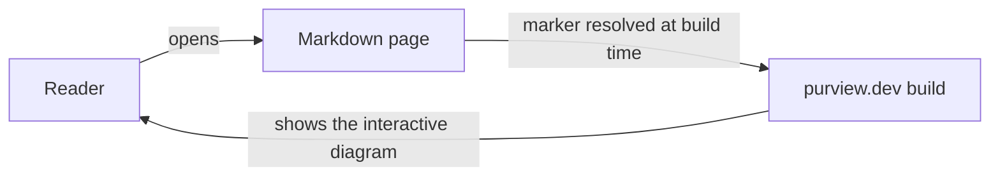
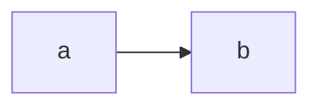

A `<!-- purview:likec4 … --> … <!-- /purview:likec4 -->` marker pair wraps a
Mermaid fence that GitHub renders as-is. AstroC4 swaps the whole block for the
named LikeC4 view instead. Unlike a ` ```likec4 ` fence, the model named by
`file="…"` can live anywhere in the repository, not just inside the site.

## Valid marker

The model is `/docs/wiki/diagrams/markers.c4`, outside this playground
entirely — `/`-rooted at the repository root, the nearest ancestor of the site
holding `.git`.

<!-- purview:likec4 file="/docs/wiki/diagrams/markers.c4" view="markerFlow" title="Marker to diagram" -->


[LikeC4 model](/docs/wiki/diagrams/markers.c4)
<!-- /purview:likec4 -->

## Undeclared view

This marker names a view the model does not declare. Markers never fail the
build: the two marker comments are removed, the Mermaid fence between them is
kept, and the build logs a warning naming the page, the line and the reason.

<!-- purview:likec4 file="/docs/wiki/diagrams/markers.c4" view="doesNotExist" title="Undeclared view" -->

<!-- /purview:likec4 -->

## Marker text in a fence

A marker inside a code fence is ignored — that is how this section, and the
marker spec's own page, can show one:

````markdown
<!-- purview:likec4 file="./diagrams/example.c4" view="example" -->

<!-- /purview:likec4 -->
````
